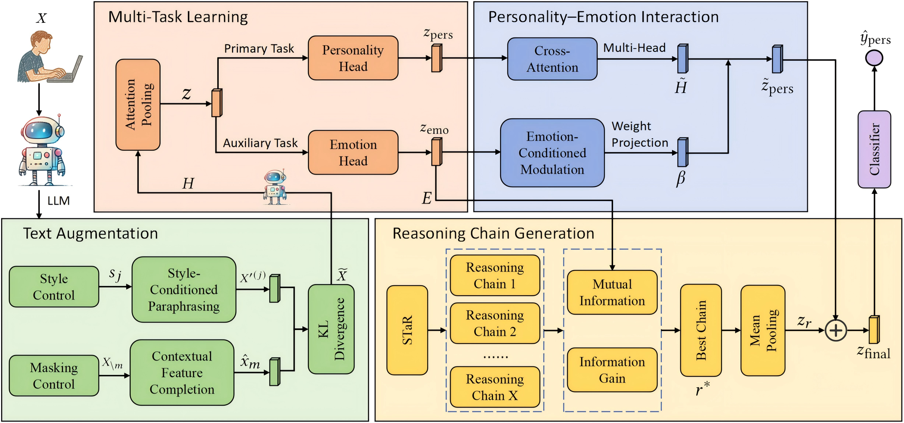

# EmoPerso

EmoPerso is a framework for emotion-aware personality detection, presented at CIKM 2025.

The model combines a frozen DeepSeek-V3 encoder with personality–emotion multi-task learning, emotion-conditioned interaction, text augmentation and reasoning-chain selection. It predicts four binary MBTI dimensions from user-level text.

## Method



Figure 2 from [Shen et al. (2025)](https://doi.org/10.1145/3746252.3761247), licensed under [CC BY 4.0](https://creativecommons.org/licenses/by/4.0/).

- Shared projection and attention pooling over frozen token representations.
- Personality classification and multi-label emotion supervision from English language cues.
- Personality–emotion cross-attention and emotion-conditioned pooling.
- Style transformation, contextual completion and prediction consistency.
- Generated reasoning candidates scored by information gain and learned emotion–reasoning association, followed by selection and residual fusion.

See [Architecture](docs/architecture.md) for tensor shapes, scoring and training objectives.

## Installation

Use Python 3.12 for the pinned environment. For CUDA, first install the appropriate [PyTorch 2.6.0 build](https://pytorch.org/get-started/previous-versions/#v260) for your system. From the repository or unpacked source distribution:

```shell
python -m pip install -r requirements.txt
python -m pip install .
```

The package supports Python 3.11 or newer. For a minimal installation, use `pip install .` for data and metrics, or `pip install ".[tokenizer]"` for tokenization alone. Use `pip install ".[backbone]"` to install model dependencies within the supported version ranges.

Provide compatible DeepSeek-V3 weights, tokenizer resources and user data. Augmentation and reasoning also need a generation model with its own tokenizer. Model loading supports local paths and explicitly enabled Hub access. Full DeepSeek-V3 needs substantial memory; configure device placement and offloading for your hardware.

## Configuration and data

Edit [configs/emoperso_train.toml](configs/emoperso_train.toml) with your resource paths and device settings. The evaluation and prediction templates use the same model settings. Resource paths in TOML/JSON resolve relative to the configuration file; CLI paths resolve relative to the current directory.

CSV/JSONL inputs contain `user_id`, `text`, and, for supervised users, MBTI labels and a `train`, `validation` or `test` partition. Post-level input also has `post_id`. Dataset identity namespaces user IDs, and all posts of a user share one partition. Unlabelled input uses `inference`.

[Data](docs/data.md) describes the schema, label encoding, cleaning and token masks. [The input example](examples/README.md) shows how to inspect batches from your files.

## Training

```shell
python -m emoperso.experiment train --config configs/emoperso_train.toml
python -m emoperso.experiment train --config configs/emoperso_train.toml --resume runs/train/checkpoints/latest.pt
```

Use a new output directory for each independent run. Training supports gradient accumulation, early stopping and epoch-boundary resume. Checkpoint selection and optional threshold fitting use validation Macro-F1.

## Evaluation and inference

```shell
python -m emoperso.experiment evaluate --config configs/emoperso_evaluate.toml --checkpoint runs/train/checkpoints/best.pt
python -m emoperso.experiment predict --config configs/emoperso_predict.toml --checkpoint runs/train/checkpoints/best.pt
```

Evaluation reports Macro-F1 for each binary dimension and their arithmetic mean. Prediction exports user identifiers, probabilities and MBTI decisions as CSV and JSONL. Keep identity-bearing outputs and generated text caches private.

[Training](docs/training.md) covers configuration, generation preparation, checkpoints and outputs. [Python API](docs/python_api.md) covers component construction and custom generators.

## Citation

```bibtex
@inproceedings{shen2025emoperso,
  title={EmoPerso: Enhancing personality detection with self-supervised emotion-aware modelling},
  author={Shen, Lingzhi and Cai, Xiaohao and Long, Yunfei and Razzak, Imran and Chen, Guanming and Jameel, Shoaib},
  booktitle={Proceedings of the 34th ACM International Conference on Information and Knowledge Management},
  pages={2577--2587},
  year={2025},
  doi={10.1145/3746252.3761247}
}
```

## License

Project-owned software uses the [MIT License](LICENSE), Copyright (c) 2025 Lingzhi Shen. Dataset, tokenizer, pretrained-weight, paper and third-party dependency rights remain separate. See [Source and licensing](CODE_PROVENANCE.md).
