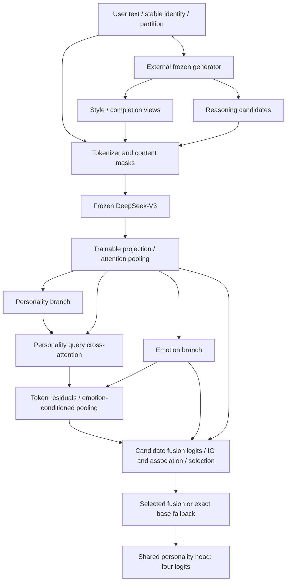

# Model architecture and objectives

[Overview](../README.md) · [Data](data.md) · [Training](training.md)

Generation is an explicit preparation step outside the differentiable model.



Views and candidates retain their original user/partition, are separately re-encoded and use the same trainable Encoder. The diagram's shared Tokenizer/Encoder nodes represent separate encoding calls for each view.

## Frozen Backbone and shared representation

`BackboneConfig`/`load_backbone` load a compatible bare native DeepSeek-V3 model. Official hidden size is 7168, while `EmoPersoEncoder` learns a projection to shared width `d` (default 4096). The width is read from actual configuration.

`FrozenBackbone` permanently disables parameter gradients, stays in eval mode even when the enclosing model trains, and extracts `[B,T,H]` hidden states without autograd. It checks Tokenizer/model compatibility. Trainable projection produces `[B,T,d]`; attention pooling over content Tokens returns `[B,d]`. Padded and special Token positions contribute no pooled content. Empty-content rows are rejected upstream.

`EmoPersoEncoder.from_pretrained(BackboneConfig(...), tokenizer=..., shared_hidden_size=..., shared_device=...)` combines these steps. Use local weights, an explicit dtype/device or device_map, and a separately selected shared device for dispatched weights. Do not call `.to()` on an entire dispatched model. No LM logits or all-layer hidden-state stack is required. Standard eager/SDPA options are explicit; flash-attention requires its own supported environment. Frozen MoE/MLA weights still require substantial memory.

## Personality and emotion tasks

`EmoPersoMTL` has two independent `Linear(d,h) → ReLU → Dropout → Linear(h,d)` branches. Personality logits `[B,4]` use positive classes E/S/F/J; emotion logits `[B,C]` use multi-label sigmoid, default ordered classes:

```text
joy anger sadness fear disgust surprise contempt
```

`prepare_targets(batch)` uses only certified visible source text. `EmotionLabeler` implements reproducible English cues, local negation, emphasis and experiential-context rules. Multiple emotions may be positive. Rows without emotion cues have `emotion_valid=False` and are excluded from emotion supervision. Negation does not manufacture an opposite emotion; punctuation alone does not determine a class. Matching does not cross real posts, special-Token gaps or truncated partial words. Sarcasm, language coverage and semantic ambiguity remain limitations.

Custom ordered categories must agree in model, labeler, targets and loss. Caller-supplied cues replace that category's phrases; unspecified built-in categories retain their rules. Supply external emotion targets explicitly in matching user and category order.

Personality BCE averages all user/dimension entries; emotion BCE averages valid users/classes. Weights default to .7/.3. `MultiTaskLoss` returns activity information: disconnected zero objectives do not cause optimizer steps. An inactive head can keep `grad=None` under AdamW, although other active losses may still train a shared representation.

## Interaction

`EmoPersoInteractionModel` wraps the MTL once. One personality query `[B,1,d]` attends to Token keys/values `[B,T,d]`, producing a global context `[B,1,d]`. The context is broadcast into per-Token residuals with LayerNorm. Dynamic emotion scores are:

```text
score_i = v^T tanh(W_h h_i + W_e z_emotion + b)
weights = masked_softmax(score)
refined = LayerNorm(z_personality + sum_i weights_i h_i)
```

Shared width must be at least 2 and divisible by num_heads (default 4). Attention scoring width defaults to min(d,256). The shared personality head classifies the refined vector. Optional cross/emotion attention weights are `[B,T]`, with padding excluded.

`InteractionLoss` applies `lambda_mtl * task_loss + lambda_cross * cross_loss`. Cross consistency is the mean `1 - cosine(refined, emotion)` on emotion-valid users, with zero-vector cosine treated as zero; no valid rows gives a disconnected zero. Personality BCE uses the refined prediction once. Turning off direct emotion classification does not freeze emotion features that still condition personality prediction.

## Text augmentation

`HFCausalLMGenerator` is a separate frozen local CausalLM with its own compatible tokenizer. Configurable generation fields include model/tokenizer source, revision, dtype, device/device_map, temperature, top_p, prompt/new-token budgets and seed. Resource loading errors raise `GenerationLoadError`; over-budget prompts and failed or unfinished responses become rejected views. Custom backends implement `generate(prompt, *, seed=None) -> GenerationResult` and expose a JSON-serializable `identity`.

`TextAugmenter` edits certified visible whole-word segments while retaining real source boundaries. Defaults request formal, expressive and concise styles plus one contextual completion. Completion masks a short contiguous phrase within a segment, then inserts only the returned phrase at its original location. Default segment budget is 1200 characters, one segment per view; completion masks about 10% of words (at most 8), requires at least 5 words and limits the proposed phrase to 20 words. See `AugmentationConfig` for adjustable budgets.

| Mode | Python configuration | Experiment setting |
|---|---|---|
| Both | `AugmentationConfig()` | `both` |
| Style only | `AugmentationConfig(completion=False)` | `style` |
| Completion only | `AugmentationConfig(styles=(), completion=True)` | `completion` |

Both off is invalid for the augmentation config; the base interface accepts an ordinary batch without augmentation. Experiment `views.augmentation="off"` selects that path. Completion-only has no Style Head or style CE. Styles, head and loss retain the same category order in checkpoints.

Quality guards reject empty/echo/invalid-format outputs, explicit MBTI mentions and detectable changes in negation, numbers, entities or emotion direction. The checks cover lexical changes; semantic preservation requires dataset-specific assessment. Failed views do not discard the original user. Pairing validates identity, partition, source/config and actual Token visibility; edits truncated away or token-identical views do not receive spurious supervision.

Style CE applies only to successful style views. Prediction consistency is the mean four-dimensional Bernoulli `KL(original.detach() || augmented)`, averaged within each user's accepted views then across contributing users; CE is also user-balanced. The original prediction is a detached target for this auxiliary term. The generator is not updated or stored in model state.

## Reasoning and fusion

`ReasoningGenerator` generates structured candidates from certified source evidence without supplying personality labels. `prepare_reasoning_batches` validates source/config/user binding and re-encodes candidates in microbatches. Shared projection/pooling is recomputed each forward; cached text never substitutes stale trainable embeddings.

For candidate c of user u, shared fusion produces candidate personality logits. Information gain is the mean binary entropy of the base four-dimensional prediction minus that of the candidate-fused prediction. Positive values indicate reduced prediction uncertainty; negative values indicate increased uncertainty.

`EmotionReasoningAssociation` compares projected, normalized emotion and candidate vectors by cosine. Candidate score is `ig_weight * IG/log(2) + association_weight * cosine`; default weights are 1. Softmax is within each user, with configurable positive temperature. Hard selection uses the highest score, with stable candidate-ID tie-breaking. No batch-level score normalization or ground-truth labels are used for inference.

Fusion is a lightweight bottleneck gated residual plus LayerNorm (default bottleneck min(d,256)), followed by the existing personality head. With no valid candidate a user's base refined vector and logits are reused exactly, rather than passing zeros through fusion. Candidate representations are `[K,d]`; final personality logits remain `[B,4]`.

Argmax has no gradient. Final BCE trains selected paths; preference entropy and contrastive learning train scoring-related modules. Preference entropy is averaged over users with candidates (singletons contribute zero), and is inactive when all choices are singleton/empty or both score weights are zero. Candidate-to-user InfoNCE uses only emotion-valid users with candidates, balances candidates within each user and requires at least two eligible users. Multiple chains of the same user are not negatives of each other. The association objective learns candidate-to-user compatibility; the generator stays frozen throughout training.

## Joint objective and gradients

```text
L = lambda_mtl * (personality_weight * BCE_final + emotion_weight * BCE_emotion)
  + lambda_cross * L_cross
  + style_weight * CE_style + consistency_weight * KL_augmentation
  + star_weight * H_preference + contrastive_weight * InfoNCE
```

Defaults: lambda_mtl=1, personality/emotion=.7/.3, and each other weight=.1. Final personality BCE is computed once. Cross consistency still uses the interaction vectors; augmentation KL uses auxiliary interaction predictions and does not generate reasoning chains per augmented view. Zero-weight or unsupported terms are disconnected, and an entirely inactive batch skips backward and optimizer/scheduler updates.

`EmoPersoReasoningModel` owns one augmentation wrapper, which owns one interaction/MTL/Encoder chain. Accessors do not register duplicate models. Category/score extra state, parameter names and registration order are part of checkpoint compatibility. Frozen Backbone and generator are external to lightweight checkpoints. View/candidate microbatching limits forward group size but does not make retained backward activations constant-memory.
